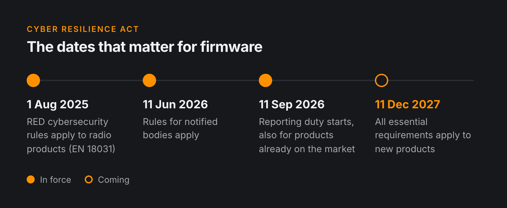
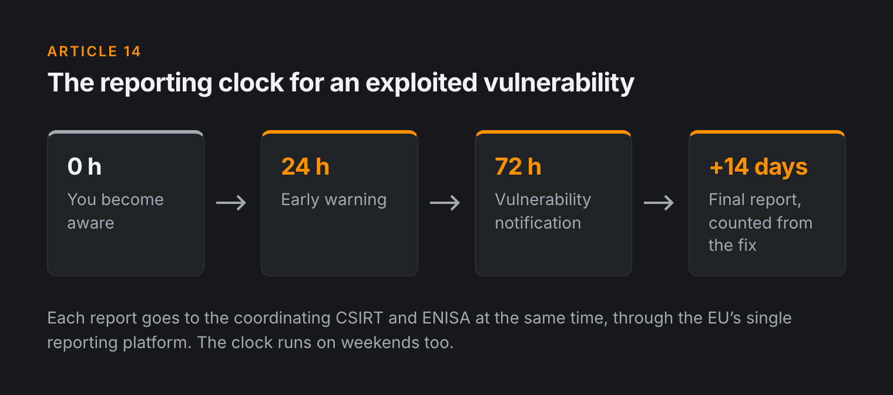
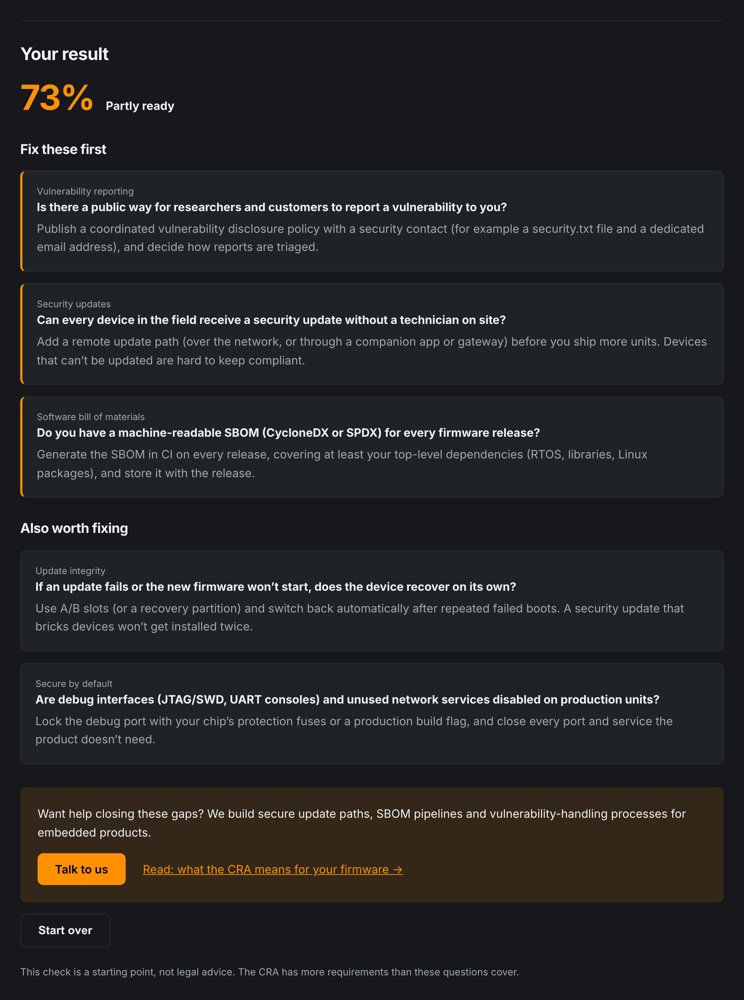
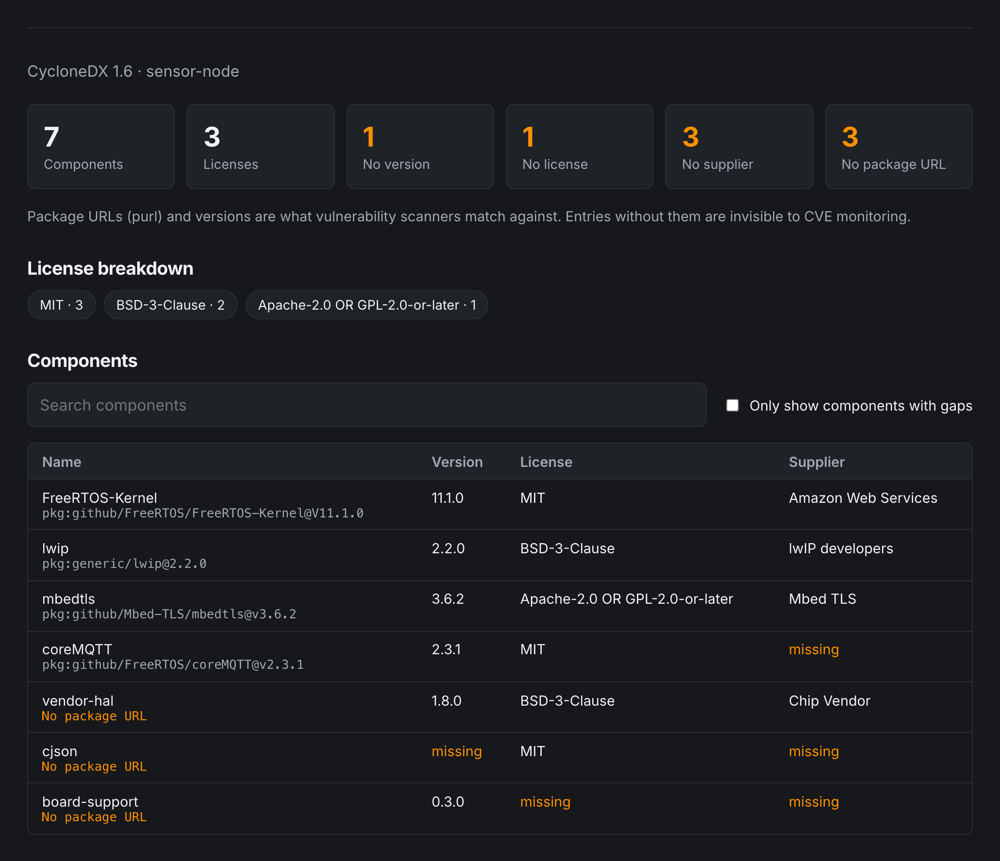

If your product has a microcontroller and a network connection, the [Cyber Resilience Act](https://eur-lex.europa.eu/eli/reg/2024/2847/oj) (CRA) isn't something for next year's roadmap anymore. The first obligations already apply, and the rest follow in a little over a year.

Most of the work ends up with the firmware team. Lawyers can write the policy, but someone still has to build the update path, generate the SBOM and actually fix the bug when it's reported.

---

## Two Dates to Remember

The CRA (Regulation (EU) 2024/2847) comes in stages, and two of the dates matter most for firmware teams.

- **11 September 2026: reporting obligations.** Manufacturers must report actively exploited vulnerabilities and severe security incidents to their national CSIRT and ENISA. You send an early warning within 24 hours and a fuller notification within 72 hours, followed by a final report no later than 14 days after a fix or mitigation is available. This applies to products **already on the market**, not only to new ones.
- **11 December 2027: full application.** From this date, products with digital elements placed on the EU market must meet the essential cybersecurity requirements in the regulation.

Penalties for breaking the essential requirements can reach **€15 million or 2.5% of worldwide annual turnover**, whichever is higher.

> The reporting duty applies today. If someone is exploiting a vulnerability in a device you shipped years ago, you have to report it now, even though most of the CRA isn't in force yet.

---

## What the CRA Asks of Firmware

The regulation is written in general terms. For embedded products, these are the requirements that matter most.

### Secure by Default

Products have to ship with a secure configuration out of the box. So no default passwords, no debug interfaces left open in production and no services listening on ports nobody uses. Users shouldn't have to harden the device themselves.

### Security Updates That Actually Arrive

Vulnerabilities must be fixable through security updates. Where applicable, those updates install **automatically by default**, with a way for the user to opt out, and they're free of charge. Where feasible, security fixes should also be kept separate from feature updates, so nobody has to take a redesign just to get a patch.

For firmware, that means you need an update mechanism you can rely on. A device that bricks itself during an update was always a headache for your support team. Under the CRA it's a compliance problem too.

### A Support Period

You have to decide how long you'll provide security updates. The default expectation is **at least five years**, unless the product is expected to be in use for a shorter time. Each security update must stay available for at least ten years after release, or for the rest of the support period if that is longer.

For an MCU product, five years of patches means your build environment, toolchain and signing keys still have to work in 2032.

### An SBOM

You need a **software bill of materials** in a common, machine-readable format, covering at least the top-level dependencies. For firmware, that includes the RTOS, vendor HALs and SDKs, the TLS library and anything pulled in through a package manager. It's easy to forget the third-party code inside a vendor SDK.

### Vulnerability Handling

You need a process for receiving and handling vulnerabilities: a **coordinated vulnerability disclosure** policy, a contact address people can actually reach, and a way to track, fix and ship patches for known issues in your components.

---

## The Standards Are Late

The CRA relies on harmonised standards to give manufacturers a clear way to show conformity. Those standards are still being written, and their deadlines have already slipped. Unfortunately, the legal deadlines haven't moved with them.

So for now there's no "just follow EN xxxx" shortcut. You'll have to read the requirements, decide what they mean for your product and write down your reasoning.

If your product has a radio, you might already be partway there. Since **1 August 2025**, the cybersecurity requirements of the Radio Equipment Directive apply, and the EN 18031 series is the harmonised standard for them. Work done for EN 18031 (authentication, secure updates, protecting network functions) carries over to the CRA.

---

## What Firmware Teams Can Do Now

You don't have to solve everything at once. Here's where we'd start:

1. **Make a product list.** Which of your products are still on the market or still receiving updates? The reporting duty already covers them.
2. **Set up a security contact.** A `security@` address, a short disclosure policy on your website, and someone responsible for reading it.
3. **Generate an SBOM in CI.** Produce it automatically on every release build, in CycloneDX or SPDX. A spreadsheet maintained by hand will be out of date after one release.
4. **Check your update path.** Can every product receive a signed update in the field? What happens if power drops halfway through? Is there a rollback?
5. **Review your defaults.** Default credentials, debug ports, open services and verbose logging in production builds.
6. **Decide on support periods.** Pick a number per product line, and check that your toolchain, keys and build servers will last that long.
7. **Write a reporting runbook.** Who decides that something is an actively exploited vulnerability, who reports it, and how do you meet a 24-hour deadline on a Saturday?

None of this is exotic. Most of it is just good engineering practice, and now there's a deadline on it.

---

## Where to Start

We built two free tools to help you get a first picture.

- **[CRA self-check](/tools/cra-check):** a short questionnaire that shows where your product stands and what to work on first.
- **[SBOM viewer](/tools/sbom):** drop in a CycloneDX or SPDX file to see what's actually inside your firmware.

If you'd like help with the firmware side, such as a secure update mechanism, SBOM generation in CI or a gap assessment for one of your products, take a look at our [secure updates and CRA readiness service](/services#updates).

> This article is a practical summary for engineering teams, not legal advice. For the exact obligations that apply to your product, read the regulation and consult a legal or compliance expert.

📧 **Contact us at [info@alsoft.nl](mailto:info@alsoft.nl)** or through our [contact page](/contact).
