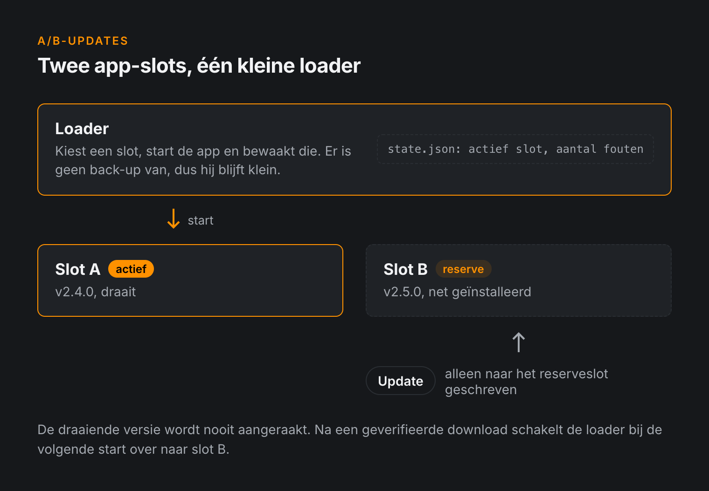
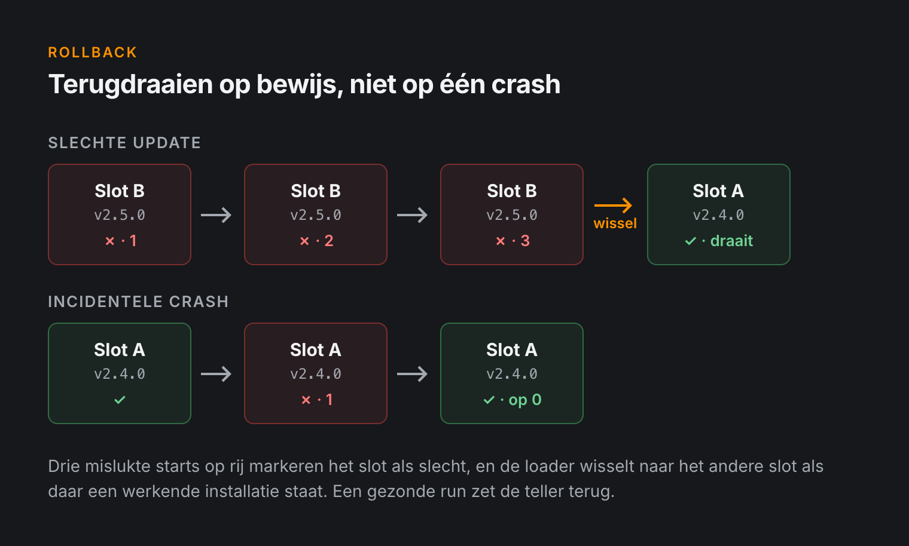
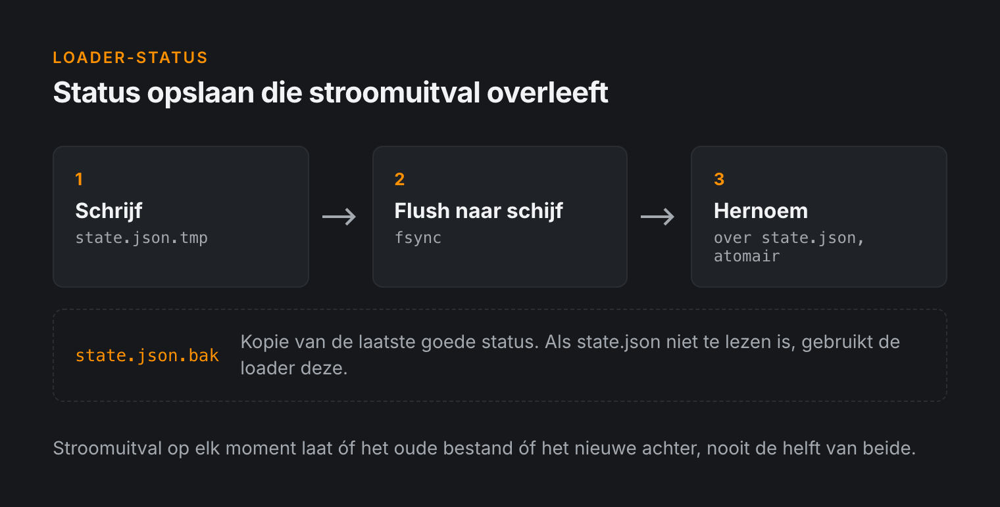

Een update die op uw bureau werkt, bewijst weinig. De echte test is een apparaat uren verderop, met een wankel netwerk, een stroomstoring midden in een installatie en niemand in de buurt die weet wat een SD-kaart is.

Wij bouwden de updateloader voor een vloot Raspberry Pi-kiosken. Dit zijn de ontwerpkeuzes die ervoor zorgden dat het bleef werken als er iets misging.

---

## Het basisidee: twee slots

De kern van het ontwerp is eenvoudig. Het apparaat bewaart **twee kopieën** van de applicatie, slot A en slot B. De ene is actief, de andere is reserve.

Een update raakt de draaiende versie nooit aan. Die wordt naar het reserveslot geschreven, en pas als de download compleet en gecontroleerd is, schakelt de loader er bij de volgende start naar over.

Komt de nieuwe versie niet op, dan schakelt de loader terug. Het apparaat draait dan de laatste versie die werkte in plaats van een half geïnstalleerde.



> Het doel is niet dat updates nooit mislukken. Het doel is dat een mislukte update nooit een bezoek ter plaatse nodig heeft.

---

## Wanneer draait u terug?

"Komt niet op" moet u precies definiëren. Eén crash is geen reden om terug te draaien, want het netwerk kan even weg zijn of een randapparaat kan traag opstarten. Wie bij elke hapering terugschakelt, krijgt een onvoorspelbare vloot.

Wij tellen daarom mislukte starts. De loader start de applicatie in het actieve slot en registreert elke poging. Stopt de applicatie meerdere keren achter elkaar met een fout, dan markeert de loader het slot als slecht en schakelt hij naar het andere.

Een vereenvoudigde versie van de logica:

```python
MAX_FAILURES = 3

def run(state):
    slot = state.active_slot

    while True:
        ok = start_and_supervise(slot)

        if ok:
            state.failures = 0
        else:
            state.failures += 1

        if state.failures >= MAX_FAILURES:
            other = "b" if slot == "a" else "a"
            if is_installed(other):
                state.active_slot = other
                state.failures = 0
                slot = other

        save_state(state)
```



De details tellen. De teller gaat terug naar nul na een gezonde run, zodat een crash om de paar weken nooit optelt tot een rollback. En de loader controleert eerst of het andere slot wel een werkende installatie bevat voordat hij ernaar overschakelt.

---

## De loader is de zwakke plek

A/B-slots geven de applicatie een back-up. De loader die tussen die slots kiest, heeft geen back-up. Er is er maar één, en als die stuk gaat, zijn beide slots onbruikbaar.

Dat verandert hoe u hem schrijft.

### Status wordt atomair weggeschreven

De loader bewaart zijn status (actief slot, aantal fouten, geïnstalleerde versies) in een klein JSON-bestand. Een stroomstoring tijdens het schrijven mag geen corrupt bestand achterlaten. Daarom passen we het nooit ter plekke aan:

1. Schrijf de nieuwe status naar een tijdelijk bestand.
2. Flush het naar schijf.
3. Hernoem het over het oude bestand heen; dat is atomair op Linux.
4. Bewaar een `.bak`-kopie van de laatste goede status en val daarop terug als het hoofdbestand niet leesbaar is.



### De loader blijft klein

De loader doet alleen wat hij moet doen: een slot kiezen, de applicatie starten, die bewaken en zo nodig wisselen. Alles wat ingewikkelder is, zit in de applicatie, die wel een back-up heeft.

### CI controleert de loader apart

Een kapotte applicatie kost u één slot. Een kapotte loader breekt elk apparaat dat hem ontvangt, want ze draaien allemaal dezelfde. Daarom compileert en controleert de buildpipeline de loader voordat er iets wordt verpakt. Een syntaxfout die anders de hele vloot zou bereiken, wordt in CI onderschept.

---

## Setupstappen die u veilig kunt herhalen

Updates gaan niet alleen over de applicatie. Na verloop van tijd hebben de apparaten ook systeemwijzigingen nodig: nieuwe pakketten, configuratie, services, loginstellingen.

Dat splitsen we op in **genummerde, geversioneerde setupstappen**. Elke stap legt vast dat hij gedraaid heeft en controleert of zijn werk al gedaan is. Is er niets veranderd, dan doet hij niets.

Dat heeft twee voordelen:

- Een setup die door een stroomstoring wordt onderbroken, kan gewoon opnieuw vanaf het begin starten.
- Een apparaat dat maanden offline is geweest, haalt de achterstand in door alleen de stappen te draaien die het gemist heeft.

---

## Een watchdog voor de watchdog

De applicatie heeft haar eigen watchdog, maar als dat watchdogproces stopt, zou niemand merken dat de applicatie vastloopt. De loader controleert daarom ook of de watchdog nog draait, en stopt de applicatie als dat niet zo is. Een vastgelopen kiosk wordt dan herstart in plaats van dagenlang bevroren op het scherm te staan.

---

## Herstart de sessie, niet het apparaat

Onze eerste versie startte na de setup de hele Raspberry Pi opnieuw op. Dat werkte, maar het was traag, en elke herstart is weer een kans dat er iets misgaat: slijtage van de SD-kaart, een traag netwerk bij het opstarten, een randapparaat dat in de verkeerde toestand opkomt.

Later hebben we dit veranderd zodat alleen de grafische sessie met de kioskinterface herstart. Het systeem blijft draaien, het netwerk blijft verbonden en de kiosk komt terug zonder volledige herstart.

---

## Starten vanaf een bekende image

Nieuwe apparaten starten vanaf een **golden SD-kaartimage**: een referentie-installatie die vooraf is gebouwd en getest. Elke kiosk in het veld begint met dezelfde basis, zodat u een probleem op één apparaat op uw bureau kunt reproduceren in plaats van op afstand te gissen.

---

## Wat we iedereen zouden meegeven die dit bouwt

- **Ga ervan uit dat de stroom op het slechtst denkbare moment uitvalt.** Schrijf elke statuswijziging zo dat een storing op elk moment te overleven is.
- **Houd het deel zonder back-up klein** en test het het zwaarst.
- **Draai terug op basis van bewijs,** niet na één enkele fout.
- **Maak elke setupstap veilig om te herhalen.**
- **Maak apparaten reproduceerbaar,** zodat problemen uit het veld in het lab na te bootsen zijn.

Geen van deze ideeën is nieuw, maar samen zorgen ze ervoor dat een slechte update een paar herstarts kost in plaats van een rit langs elke locatie.

---

## Bouwt u een updatesysteem?

Hebben uw apparaten betrouwbare updates in het veld nodig, of het nu gaat om A/B-slots op embedded Linux, een veilige bootloader op een microcontroller of de voorbereiding op de Cyber Resilience Act, bekijk dan onze dienst [veilige updates](/nl/services#updates).

📧 **Neem contact op via [info@alsoft.nl](mailto:info@alsoft.nl)** of via onze [contactpagina](/nl/contact).
