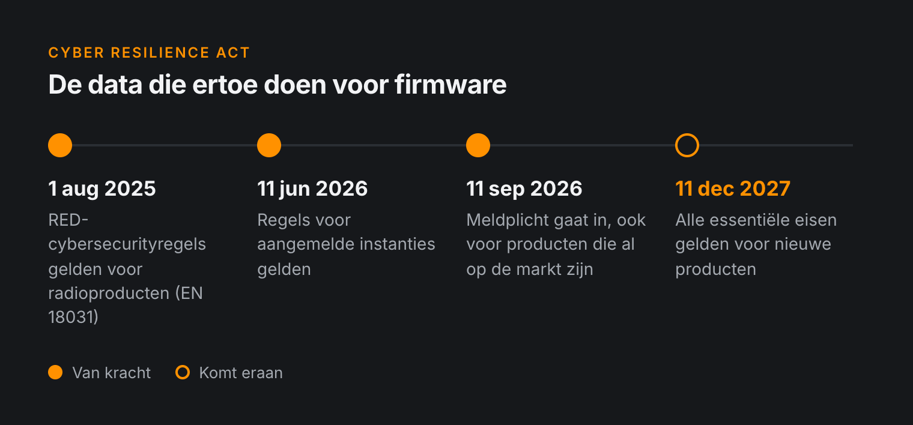
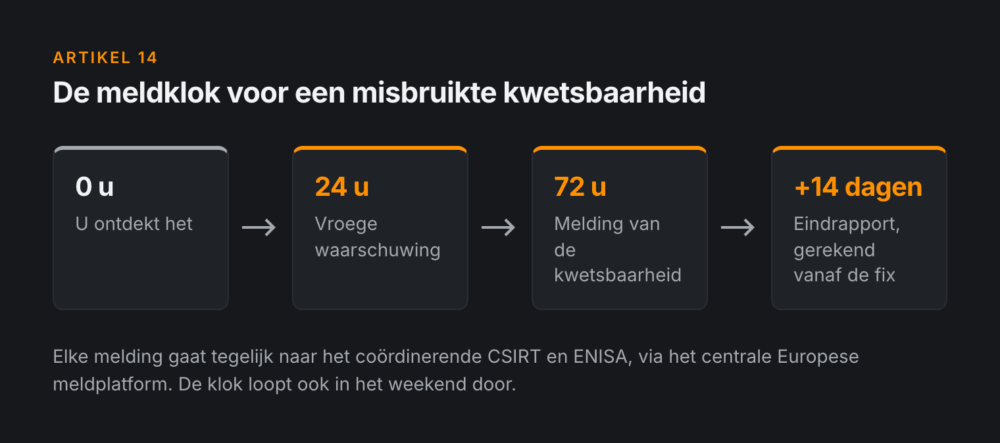
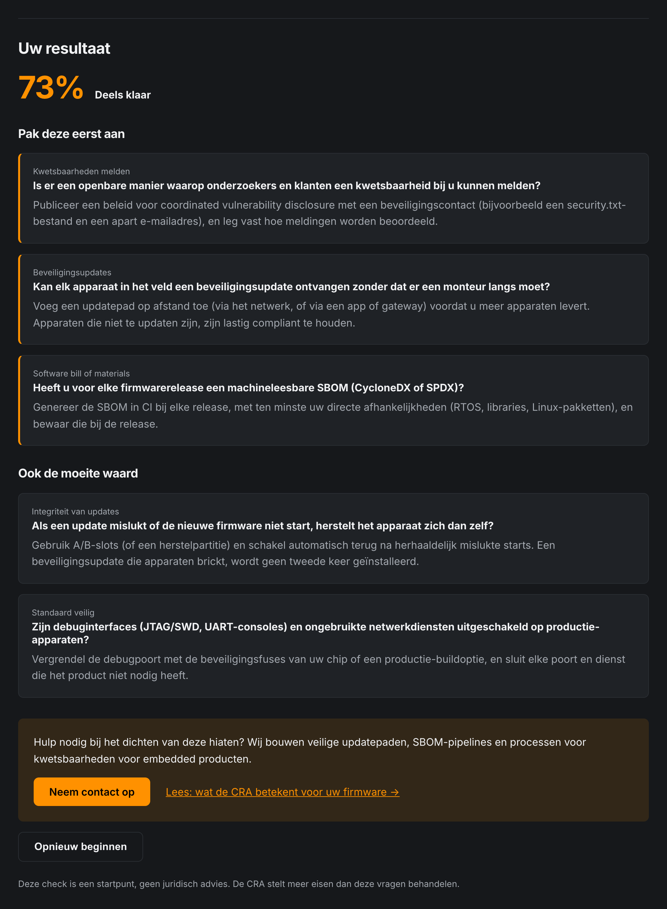
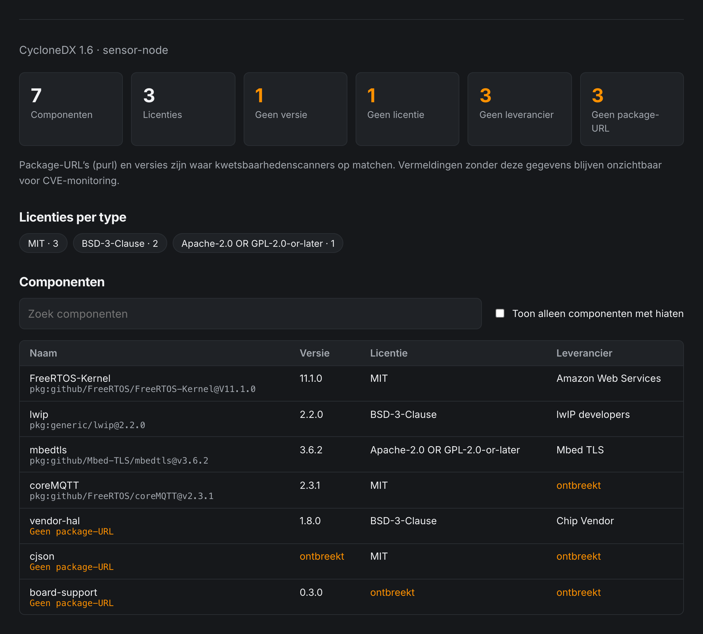

Zit er in uw product een microcontroller en een netwerkverbinding, dan hoort de [Cyber Resilience Act](https://eur-lex.europa.eu/eli/reg/2024/2847/oj) (CRA) niet meer op de roadmap van volgend jaar. De eerste verplichtingen gelden al, en de rest volgt over iets meer dan een jaar.

Het meeste werk komt bij het firmwareteam terecht. Juristen kunnen het beleid schrijven, maar iemand moet nog steeds het updatepad bouwen, de SBOM genereren en de bug echt oplossen als die gemeld wordt.

---

## Twee data om te onthouden

De CRA (Verordening (EU) 2024/2847) wordt in fasen ingevoerd, en voor firmwareteams zijn twee data het belangrijkst.

- **11 september 2026: meldplicht.** Fabrikanten moeten actief misbruikte kwetsbaarheden en ernstige beveiligingsincidenten melden bij hun nationale CSIRT en ENISA. U stuurt binnen 24 uur een vroege waarschuwing en binnen 72 uur een uitgebreidere melding, gevolgd door een eindrapport uiterlijk 14 dagen nadat er een oplossing of mitigatie beschikbaar is. Dit geldt ook voor producten die **al op de markt zijn**, niet alleen voor nieuwe.
- **11 december 2027: volledige toepassing.** Vanaf dat moment moeten producten met digitale elementen die op de Europese markt komen voldoen aan de essentiële cyberbeveiligingseisen uit de verordening.

Wie de essentiële eisen niet naleeft, riskeert boetes tot **€15 miljoen of 2,5% van de wereldwijde jaaromzet**, afhankelijk van wat hoger is.

> De meldplicht geldt vandaag al. Misbruikt iemand een kwetsbaarheid in een apparaat dat u jaren geleden heeft geleverd, dan moet u dat nu melden, ook al is het grootste deel van de CRA nog niet van kracht.

---

## Wat de CRA van firmware vraagt

De verordening is algemeen geformuleerd. Voor embedded producten zijn dit de eisen die het meest uitmaken.

### Standaard veilig

Producten moeten direct veilig geconfigureerd geleverd worden. Dus geen standaardwachtwoorden, geen debuginterfaces die in productie openstaan en geen services die luisteren op poorten die niemand gebruikt. Gebruikers horen het apparaat niet zelf te hoeven dichttimmeren.

### Beveiligingsupdates die echt aankomen

Kwetsbaarheden moeten met beveiligingsupdates op te lossen zijn. Waar van toepassing worden die updates **standaard automatisch** geïnstalleerd, met een mogelijkheid voor de gebruiker om zich af te melden, en zijn ze gratis. Waar mogelijk houdt u beveiligingsfixes ook gescheiden van functionele updates, zodat niemand een complete vernieuwing hoeft te installeren alleen om een patch te krijgen.

Voor firmware betekent dit dat u een updatemechanisme nodig heeft waar u op kunt bouwen. Een apparaat dat zichzelf tijdens een update brickt, was altijd al hoofdpijn voor uw supportteam. Onder de CRA is het ook een complianceprobleem.

### Een ondersteuningsperiode

U moet bepalen hoe lang u beveiligingsupdates levert. Het uitgangspunt is **minstens vijf jaar**, tenzij het product naar verwachting korter in gebruik is. Elke beveiligingsupdate moet na verschijning minstens tien jaar beschikbaar blijven, of voor de rest van de ondersteuningsperiode als die langer is.

Voor een MCU-product betekent vijf jaar patches dat uw buildomgeving, toolchain en ondertekeningssleutels in 2032 nog moeten werken.

### Een SBOM

U heeft een **software bill of materials** nodig in een gangbaar, machineleesbaar formaat, met minstens de directe afhankelijkheden. Voor firmware zijn dat onder meer de RTOS, HAL's en SDK's van de leverancier, de TLS-library en alles wat via een package manager binnenkomt. De code van derden in een leveranciers-SDK vergeet u makkelijk.

### Omgaan met kwetsbaarheden

U heeft een proces nodig om kwetsbaarheden te ontvangen en af te handelen: een beleid voor **gecoördineerde openbaarmaking**, een contactadres dat mensen echt kunnen bereiken, en een manier om bekende problemen in uw componenten te volgen, op te lossen en te patchen.

---

## De normen zijn laat

De CRA leunt op geharmoniseerde normen om fabrikanten een duidelijke manier te geven om conformiteit aan te tonen. Die normen worden nog geschreven en hun deadlines zijn al verschoven. Helaas zijn de wettelijke deadlines niet mee verschoven.

Voorlopig is er dus geen "volg gewoon EN xxxx"-route. U zult de eisen moeten lezen, bepalen wat ze voor uw product betekenen en uw redenering opschrijven.

Heeft uw product een radio, dan bent u misschien al op de goede weg. Sinds **1 augustus 2025** gelden de cyberbeveiligingseisen van de Radio Equipment Directive, met de EN 18031-reeks als geharmoniseerde norm. Werk dat u voor EN 18031 heeft gedaan (authenticatie, veilige updates, bescherming van netwerkfuncties) neemt u mee naar de CRA.

---

## Wat firmwareteams nu kunnen doen

U hoeft niet alles tegelijk op te lossen. Hier zouden wij beginnen:

1. **Maak een productlijst.** Welke van uw producten zijn nog op de markt of krijgen nog updates? Op die producten is de meldplicht al van toepassing.
2. **Richt een beveiligingscontact in.** Een `security@`-adres, een kort openbaarmakingsbeleid op uw website en iemand die verantwoordelijk is voor het lezen ervan.
3. **Genereer een SBOM in CI.** Laat die automatisch ontstaan bij elke releasebuild, in CycloneDX of SPDX. Een spreadsheet die u met de hand bijhoudt, is na één release al verouderd.
4. **Controleer uw updatepad.** Kan elk product in het veld een ondertekende update ontvangen? Wat gebeurt er als de stroom halverwege uitvalt? Is er een rollback?
5. **Loop uw standaardinstellingen na.** Standaardwachtwoorden, debugpoorten, open services en uitgebreide logging in productiebuilds.
6. **Bepaal ondersteuningsperiodes.** Kies per productlijn een termijn en controleer of uw toolchain, sleutels en buildservers zo lang meegaan.
7. **Schrijf een draaiboek voor meldingen.** Wie besluit dat iets een actief misbruikte kwetsbaarheid is, wie meldt het, en hoe haalt u een deadline van 24 uur op een zaterdag?

Niets hiervan is exotisch. Het meeste is gewoon goed vakmanschap, alleen zit er nu een deadline op.

---

## Waar begint u?

We hebben twee gratis tools gemaakt waarmee u een eerste beeld krijgt.

- **[CRA-zelftest](/nl/tools/cra-check):** een korte vragenlijst die laat zien waar uw product staat en waar u het eerst aan moet werken.
- **[SBOM-viewer](/nl/tools/sbom):** sleep er een CycloneDX- of SPDX-bestand in en zie wat er echt in uw firmware zit.

Wilt u hulp met de firmwarekant, zoals een veilig updatemechanisme, SBOM-generatie in CI of een gap-analyse voor een van uw producten, bekijk dan onze dienst [veilige updates en CRA-gereedheid](/nl/services#updates).

> Dit artikel is een praktische samenvatting voor engineeringteams, geen juridisch advies. Lees voor de precieze verplichtingen voor uw product de verordening en raadpleeg een juridisch of compliance-expert.

📧 **Neem contact op via [info@alsoft.nl](mailto:info@alsoft.nl)** of via onze [contactpagina](/nl/contact).
